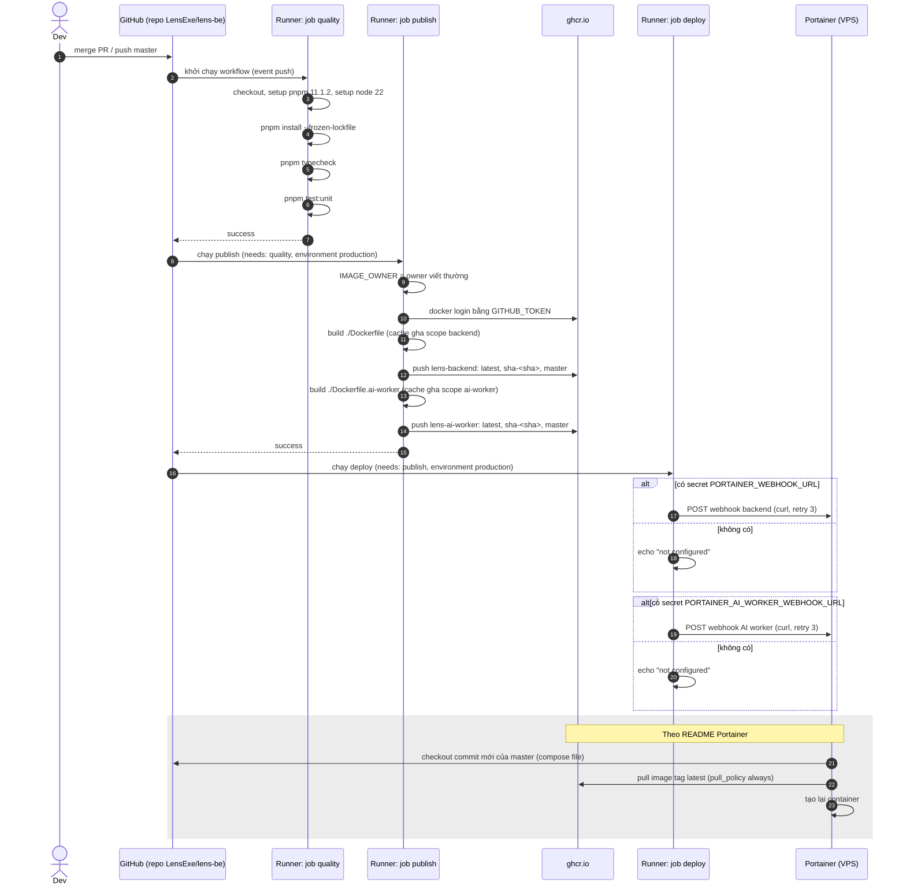
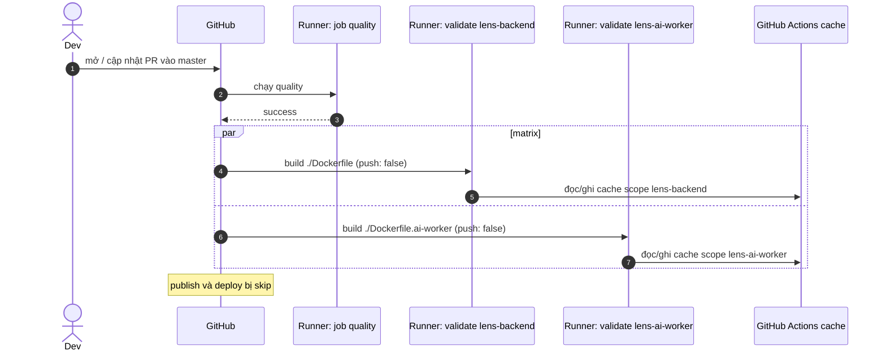

# CI/CD của Lens Backend

Tài liệu này giải thích pipeline trong [ci-cd.yml](../.github/workflows/ci-cd.yml) từ đầu đến cuối: khi nào nó chạy, từng job và từng step làm gì, image Docker được build ra sao, image đó tới VPS bằng đường nào, và những việc pipeline **không** làm.

Mọi nhận định đều dẫn `file:dòng` để tự mở ra đối chiếu. Chỗ nào là hành vi của công cụ bên ngoài (GitHub Actions, Docker, Portainer) mà repo không tự chứng minh được thì ghi rõ là "theo tài liệu của công cụ".

> Repo chỉ có **một** workflow: thư mục `.github/workflows/` chỉ chứa `ci-cd.yml`.

## Mục lục

1. [Tổng quan luồng](#1-tổng-quan-luồng)
2. [Kiểm tra ở máy local trước khi tới CI](#2-kiểm-tra-ở-máy-local-trước-khi-tới-ci)
3. [Trigger: khi nào workflow chạy](#3-trigger-khi-nào-workflow-chạy)
4. [Permissions](#4-permissions)
5. [Job `quality`](#5-job-quality--validate-backend)
6. [Job `validate-images`](#6-job-validate-images--chỉ-chạy-trên-pull-request)
7. [Job `publish`](#7-job-publish--build-và-push-image-lên-ghcr)
8. [Job `deploy`](#8-job-deploy--gọi-webhook-portainer)
9. [Hai Dockerfile](#9-hai-dockerfile)
10. [`.dockerignore`](#10-dockerignore)
11. [Image tag strategy](#11-image-tag-strategy)
12. [Cache](#12-cache)
13. [Phía server: Portainer dùng image thế nào](#13-phía-server-portainer-dùng-image-thế-nào)
14. [Secret, variable và env được dùng](#14-secret-variable-và-env-được-dùng)
15. [Những gì CI KHÔNG làm](#15-những-gì-ci-không-làm)
16. [Chạy lại và debug một run fail](#16-chạy-lại-và-debug-một-run-fail)
17. [Cách thêm một step hoặc job mới](#17-cách-thêm-một-step-hoặc-job-mới)
18. [Checklist khi đổi Dockerfile](#18-checklist-khi-đổi-dockerfile)
19. [Rollback](#19-rollback)
20. [Câu hỏi thường gặp](#20-câu-hỏi-thường-gặp)
21. [Điểm cần lưu ý](#21-điểm-cần-lưu-ý)

Phụ lục:

- [A. Đọc `ci-cd.yml` từng dòng](#phụ-lục-a-đọc-ci-cdyml-từng-dòng)
- [B. Khái niệm GitHub Actions dùng trong workflow](#phụ-lục-b-khái-niệm-github-actions-dùng-trong-workflow)
- [C. Đọc hai Dockerfile từng instruction](#phụ-lục-c-đọc-hai-dockerfile-từng-instruction)
- [D. Bảng tra cứu lỗi nhanh](#phụ-lục-d-bảng-tra-cứu-lỗi-nhanh)
- [E. Glossary](#phụ-lục-e-glossary)

---

## 1. Tổng quan luồng

Workflow tên `Lens Backend CI/CD` ([ci-cd.yml:1](../.github/workflows/ci-cd.yml)) có 4 job. Job nào chạy phụ thuộc vào **sự kiện** kích hoạt:

| Job               | Tên hiển thị                         | Chạy khi                            | Phụ thuộc (`needs`) | Dòng    |
| ----------------- | ------------------------------------ | ----------------------------------- | ------------------- | ------- |
| `quality`         | Validate backend                     | Mọi sự kiện                         | —                   | 17–42   |
| `validate-images` | Validate `<service>` Docker image    | Chỉ `pull_request`                  | `quality`           | 44–73   |
| `publish`         | Publish backend and AI worker images | Mọi sự kiện **khác** `pull_request` | `quality`           | 75–138  |
| `deploy`          | Redeploy Portainer stack             | Mọi sự kiện **khác** `pull_request` | `publish`           | 140–168 |

### Luồng khi mở / cập nhật Pull Request vào `master`

```text
PR → master
  │
  ▼
quality (checkout → pnpm → node → install → typecheck → unit test)
  │  pass
  ▼
validate-images (matrix 2 job song song)
  ├─ build ./Dockerfile           → tag lens-backend:pr-validation   (KHÔNG push)
  └─ build ./Dockerfile.ai-worker → tag lens-ai-worker:pr-validation (KHÔNG push)

publish, deploy: bị skip (if: event != pull_request)
```

### Luồng khi push lên `master` (merge PR) hoặc bấm chạy tay

```text
push master / workflow_dispatch
  │
  ▼
quality
  │  pass
  ▼
publish (environment: production)
  ├─ build ./Dockerfile           → push ghcr.io/<owner>/lens-backend:{latest, sha-<sha>, <branch>}
  └─ build ./Dockerfile.ai-worker → push ghcr.io/<owner>/lens-ai-worker:{latest, sha-<sha>, <branch>}
  │
  ▼
deploy (environment: production)
  ├─ có secret PORTAINER_WEBHOOK_URL?           → curl POST → Portainer redeploy stack backend
  └─ có secret PORTAINER_AI_WORKER_WEBHOOK_URL? → curl POST → Portainer redeploy stack ai-worker
  │
  ▼
Portainer (trên VPS) pull lại image `latest` từ GHCR và tạo lại container
```

Điểm mấu chốt để nhớ:

- CI **không SSH** vào server, không chạy `docker` trên server. Nó chỉ làm 2 việc ra bên ngoài: **push image lên GHCR** và **gọi một URL webhook** của Portainer ([ci-cd.yml:152–164](../.github/workflows/ci-cd.yml)).
- Server tự đi kéo image về (pull model), CI chỉ "bấm chuông" báo có bản mới.

### Sequence diagram (push `master`)

Sơ đồ dưới vẽ đúng các bước có trong [ci-cd.yml](../.github/workflows/ci-cd.yml) và [deploy/portainer/README.md:52–54](../deploy/portainer/README.md). Phần trong khối "Portainer" là hành vi được README mô tả, workflow không quan sát được.



### Sequence diagram (Pull Request)



---

## 2. Kiểm tra ở máy local trước khi tới CI

Trước khi code lên GitHub, repo đã cài sẵn vài lớp kiểm tra chạy trên máy dev bằng Husky. Chúng **không** phải là CI, nhưng nên hiểu để biết lớp nào bắt lỗi gì.

### 2.1 Husky được cài thế nào

- Script `"prepare": "husky"` ([package.json:32](../package.json)). `prepare` là lifecycle script mà pnpm/npm tự chạy sau `pnpm install`, nên ai clone repo rồi `pnpm install` là hook được kích hoạt.
- Thư mục `.husky/_` chứa phần ruột do Husky sinh ra; các hook do repo viết nằm ở `.husky/pre-commit`, `.husky/commit-msg`, `.husky/post-merge`.

### 2.2 `pre-commit`

[.husky/pre-commit](../.husky/pre-commit):

```sh
# node scripts/secrets-auto.mjs pre-commit
# node scripts/secrets-guard.mjs
npx lint-staged
```

- Dòng 1–2 đang **bị comment**, tức là `secrets-auto` và `secrets-guard` hiện **không chạy**.
- Dòng 3 chạy `lint-staged`, cấu hình ở [.lintstagedrc.json](../.lintstagedrc.json):

  | Pattern file           | Lệnh chạy trên file đã `git add`                         | Dòng |
  | ---------------------- | -------------------------------------------------------- | ---- |
  | `*.{ts,js}`            | `prettier --write`, rồi `eslint --fix --no-warn-ignored` | 2    |
  | `*.{json,yaml,yml,md}` | `prettier --write`                                       | 3    |

  `lint-staged` chỉ đụng vào **file đang staged**, không phải toàn repo. Prettier dùng [.prettierrc](../.prettierrc) (`singleQuote: true`, `trailingComma: "all"`).

### 2.3 `commit-msg`

[.husky/commit-msg:1](../.husky/commit-msg) chạy `npx --no -- commitlint --edit "$1"`. Luật ở [.commitlintrc.json](../.commitlintrc.json): kế thừa `@commitlint/config-conventional` (dòng 2) và nới `header-max-length` lên 150 ký tự (dòng 4). Commit message sai dạng `type(scope): msg` sẽ bị chặn ngay tại máy.

### 2.4 `post-merge`

[.husky/post-merge:1](../.husky/post-merge) chỉ có một dòng **đã comment** (`secrets-auto.mjs post-merge`), nên hiện không làm gì.

### 2.5 So sánh lớp local và lớp CI

| Kiểm tra                   | Local (Husky)        | CI (`quality`)                                         |
| -------------------------- | -------------------- | ------------------------------------------------------ |
| Prettier                   | Có, trên file staged | **Không**                                              |
| ESLint                     | Có, trên file staged | **Không**                                              |
| Commit message             | Có (commitlint)      | **Không**                                              |
| Typecheck (`tsc --noEmit`) | **Không**            | Có ([ci-cd.yml:38–39](../.github/workflows/ci-cd.yml)) |
| Unit test                  | **Không**            | Có ([ci-cd.yml:41–42](../.github/workflows/ci-cd.yml)) |
| Build Docker image         | **Không**            | Có (PR: chỉ build; master: build + push)               |

Hệ quả: hook local có thể bị bỏ qua bằng `git commit --no-verify`, và CI cũng không chạy lại ESLint/Prettier. Xem [mục 21](#21-điểm-cần-lưu-ý).

---

## 3. Trigger: khi nào workflow chạy

```yaml
on:
  pull_request:
    branches:
      - master
  push:
    branches:
      - master
  workflow_dispatch:
```

([ci-cd.yml:3–10](../.github/workflows/ci-cd.yml))

| Sự kiện                   | Ý nghĩa                                                                                                              | `github.event_name` |
| ------------------------- | -------------------------------------------------------------------------------------------------------------------- | ------------------- |
| `pull_request` → `master` | PR có **base** là `master` được mở, push thêm commit, hoặc reopen (các activity type mặc định theo tài liệu GitHub). | `pull_request`      |
| `push` → `master`         | Có commit mới trên `master` (thường là khi merge PR).                                                                | `push`              |
| `workflow_dispatch`       | Bấm nút **Run workflow** trên tab Actions. Lúc bấm, GitHub cho chọn branch để chạy.                                  | `workflow_dispatch` |

Những thứ workflow **không** khai báo:

- **Không có `paths` / `paths-ignore`**: sửa một file `.md` trong `docs/` rồi push `master` cũng chạy đủ 4 job, kể cả build, push image và redeploy.
- **Không có `concurrency`**: hai lần push liên tiếp sinh ra hai run chạy song song, không run nào bị hủy. Xem [mục 21](#21-điểm-cần-lưu-ý).
- **Không có `schedule`** (cron) và không có trigger theo tag (`push: tags`).

### Điều kiện ở cấp job

Ba job sau dùng `if:` dựa vào `github.event_name`:

- `validate-images`: `if: ${{ github.event_name == 'pull_request' }}` ([ci-cd.yml:46](../.github/workflows/ci-cd.yml)).
- `publish`: `if: ${{ github.event_name != 'pull_request' }}` ([ci-cd.yml:77](../.github/workflows/ci-cd.yml)).
- `deploy`: `if: ${{ github.event_name != 'pull_request' }}` ([ci-cd.yml:142](../.github/workflows/ci-cd.yml)).

Lưu ý chữ `!=`: điều kiện của `publish`/`deploy` là "không phải PR", nên nó đúng cho **cả** `push` lẫn `workflow_dispatch`. Workflow không kiểm branch ở đây.

---

## 4. Permissions

```yaml
permissions:
  contents: read
  packages: write
```

([ci-cd.yml:12–14](../.github/workflows/ci-cd.yml))

Khối này đặt ở **cấp workflow**, nên áp cho mọi job. Nó quyết định quyền của token tự động `GITHUB_TOKEN` mà GitHub cấp cho mỗi run:

- `contents: read`: đủ để `actions/checkout` đọc code.
- `packages: write`: cho phép push image lên GitHub Container Registry (GHCR). Job `publish` dùng chính `GITHUB_TOKEN` để login GHCR ([ci-cd.yml:96](../.github/workflows/ci-cd.yml)).
- Mọi quyền không liệt kê thì bị đặt thành `none` (theo tài liệu GitHub: khi khai báo `permissions`, các scope không nêu sẽ không có quyền).

Job `quality` và `validate-images` cũng nhận `packages: write` dù không cần. Xem [mục 21](#21-điểm-cần-lưu-ý).

---

## 5. Job `quality` — Validate backend

([ci-cd.yml:17–42](../.github/workflows/ci-cd.yml))

Đây là "cổng" đầu tiên. `validate-images` và `publish` đều `needs: quality` ([ci-cd.yml:47](../.github/workflows/ci-cd.yml), [ci-cd.yml:78](../.github/workflows/ci-cd.yml)), nên `quality` fail thì không có image nào được build.

- `runs-on: ubuntu-latest` ([dòng 19](../.github/workflows/ci-cd.yml)): chạy trên runner Linux do GitHub host. Mỗi job được một máy ảo mới tinh, không chia sẻ file với job khác.

### Step 1 — Checkout

```yaml
- name: Checkout
  uses: actions/checkout@v4
```

([dòng 21–22](../.github/workflows/ci-cd.yml)) Clone code của commit đang chạy vào runner. Với `pull_request`, theo tài liệu GitHub, commit được checkout là merge commit giả lập (PR merge vào `master`), không phải đầu nhánh PR. Nghĩa là CI kiểm "code sau khi merge" chứ không chỉ "code trên nhánh".

### Step 2 — Setup pnpm

```yaml
- name: Setup pnpm
  uses: pnpm/action-setup@v4
  with:
    version: 11.1.2
```

([dòng 24–27](../.github/workflows/ci-cd.yml)) Cài đúng pnpm `11.1.2`. Phiên bản này được ghim bằng tay: [package.json](../package.json) **không có** trường `packageManager`, nên action không tự suy ra được. Step này phải đứng **trước** `setup-node`, vì step sau dùng `cache: pnpm` cần lệnh `pnpm` có sẵn để tìm thư mục store.

### Step 3 — Setup Node.js

```yaml
- name: Setup Node.js
  uses: actions/setup-node@v4
  with:
    node-version: 22
    cache: pnpm
```

([dòng 29–33](../.github/workflows/ci-cd.yml))

- `node-version: 22`: khớp với base image `node:22-bookworm-slim` trong cả hai Dockerfile ([Dockerfile:3](../Dockerfile), [Dockerfile:30](../Dockerfile)).
- `cache: pnpm`: theo tài liệu `setup-node`, nó cache **pnpm store** (kho package đã tải) với key tính từ hash của `pnpm-lock.yaml`. Lockfile không đổi thì lần sau `pnpm install` lấy từ cache, không tải lại từ registry. Đây là cache của job `quality`, khác hoàn toàn với cache Docker layer ở [mục 12](#12-cache).

### Step 4 — Install dependencies

```yaml
run: pnpm install --frozen-lockfile
```

([dòng 35–36](../.github/workflows/ci-cd.yml)) `--frozen-lockfile` nghĩa là: nếu `package.json` và `pnpm-lock.yaml` lệch nhau thì **fail** thay vì tự sửa lockfile. Đây là lỗi hay gặp khi ai đó sửa `package.json` mà quên commit lockfile.

Chú ý: `pnpm install` cũng chạy script `prepare` → `husky` ([package.json:32](../package.json)). Trên CI việc này vô hại.

Package nào được phép chạy build script khi install được khai báo trong [pnpm-workspace.yaml:1–5](../pnpm-workspace.yaml) (`allowBuilds`).

### Step 5 — Typecheck

```yaml
run: pnpm typecheck
```

([dòng 38–39](../.github/workflows/ci-cd.yml)) → `tsc --noEmit` ([package.json:59](../package.json)).

- Dùng [tsconfig.json](../tsconfig.json) ở gốc repo. File này **không có** `include`/`exclude`, nên theo luật mặc định của TypeScript nó kiểm mọi file `.ts` trong repo (trừ `node_modules` và `outDir`), tức là gồm cả `apps/*`, `src/` và `test/`.
- `--noEmit`: chỉ kiểm kiểu, không sinh file JS.
- Luật kiểu đáng nhớ: `strictNullChecks: true` nhưng `noImplicitAny: false` ([tsconfig.json:19](../tsconfig.json), [tsconfig.json:21](../tsconfig.json)).

Typecheck **không** thay cho `nest build`. Build thật chỉ xảy ra bên trong Docker (xem [mục 9](#9-hai-dockerfile)).

### Step 6 — Unit tests

```yaml
run: pnpm test:unit
```

([dòng 41–42](../.github/workflows/ci-cd.yml)) → `node -r ts-node/register -r tsconfig-paths/register --test test/*.test.ts` ([package.json:56](../package.json)).

- Dùng test runner có sẵn của Node (`node --test`), không phải Jest.
- `-r ts-node/register`: cho Node chạy thẳng file `.ts`.
- `-r tsconfig-paths/register`: để import alias `@modules/*`, `@shared/*`, `@features/*` ([tsconfig.json:24–28](../tsconfig.json)) chạy được lúc runtime.
- Glob `test/*.test.ts` **chỉ** bắt file đuôi `.test.ts`. Vì vậy `test/openapi.contract.ts` và `test/lens.integration.ts` **không chạy** trên CI. Các file như `domain-boundaries.test.ts`, `kong-config.contract.test.ts` thì có chạy vì đuôi `.test.ts`.
- `pnpm test` ([package.json:27](../package.json)) và `pnpm test:unit` có câu lệnh y hệt nhau.
- Các script Jest (`test:watch`, `test:cov`, `test:e2e`, [package.json:28–31](../package.json)) không được CI gọi.

---

## 6. Job `validate-images` — chỉ chạy trên Pull Request

([ci-cd.yml:44–73](../.github/workflows/ci-cd.yml))

Mục đích: chứng minh cả hai Dockerfile **build được** trước khi merge, nhưng **không** đẩy image đi đâu.

### Matrix

```yaml
strategy:
  matrix:
    include:
      - service: lens-backend
        dockerfile: ./Dockerfile
        tag: lens-backend:pr-validation
      - service: lens-ai-worker
        dockerfile: ./Dockerfile.ai-worker
        tag: lens-ai-worker:pr-validation
```

([dòng 49–57](../.github/workflows/ci-cd.yml)) `matrix.include` sinh ra **2 job con chạy song song**, mỗi job nhận bộ biến `service`, `dockerfile`, `tag` riêng. Tên job hiển thị là `Validate ${{ matrix.service }} Docker image` ([dòng 45](../.github/workflows/ci-cd.yml)), nên trên giao diện bạn thấy 2 dòng: "Validate lens-backend Docker image" và "Validate lens-ai-worker Docker image".

Mặc định của matrix (theo tài liệu GitHub) là `fail-fast: true`: một job con fail thì job con còn lại bị hủy.

### Step 1 — Checkout

([dòng 59–60](../.github/workflows/ci-cd.yml)) Như ở `quality`. Job này chạy trên máy mới, nên phải checkout lại.

### Step 2 — Setup Docker Buildx

```yaml
uses: docker/setup-buildx-action@v3
```

([dòng 62–63](../.github/workflows/ci-cd.yml)) Tạo một builder BuildKit. Cần builder này thì mới dùng được cache kiểu `type=gha` ở step sau (driver `docker` mặc định không hỗ trợ cache export này, theo tài liệu Docker).

### Step 3 — Build image without publishing

```yaml
uses: docker/build-push-action@v6
with:
  context: .
  file: ${{ matrix.dockerfile }}
  push: false
  tags: ${{ matrix.tag }}
  cache-from: type=gha,scope=${{ matrix.service }}
  cache-to: type=gha,mode=max,scope=${{ matrix.service }}
```

([dòng 65–73](../.github/workflows/ci-cd.yml))

| Tham số       | Ý nghĩa                                                                                                    |
| ------------- | ---------------------------------------------------------------------------------------------------------- |
| `context: .`  | Gửi toàn bộ thư mục repo (đã lọc qua [.dockerignore](../.dockerignore)) làm build context.                 |
| `file`        | Dockerfile lấy từ matrix.                                                                                  |
| `push: false` | Build xong thì thôi, không push. Image nằm trong cache của builder rồi biến mất khi runner tắt.            |
| `tags`        | `lens-backend:pr-validation` / `lens-ai-worker:pr-validation`. Chỉ là tên local, không có registry prefix. |
| `cache-from`  | Đọc layer cache từ GitHub Actions cache, scope `lens-backend` hoặc `lens-ai-worker`.                       |
| `cache-to`    | Ghi cache lại. `mode=max` = lưu cả layer của stage trung gian (`build`), không chỉ stage cuối.             |

Job này **không cần secret nào**, nên PR từ fork vẫn chạy được (theo tài liệu GitHub, PR từ fork không nhận secret của repo).

Cache scope ở đây (`lens-backend`, `lens-ai-worker`) **khác** với scope ở job `publish` (`backend`, `ai-worker`). Xem [mục 12](#12-cache).

---

## 7. Job `publish` — build và push image lên GHCR

([ci-cd.yml:75–138](../.github/workflows/ci-cd.yml))

```yaml
publish:
  if: ${{ github.event_name != 'pull_request' }}
  needs: quality
  runs-on: ubuntu-latest
  environment: production
```

- `environment: production` ([dòng 80](../.github/workflows/ci-cd.yml)): gắn job vào GitHub Environment tên `production`. Theo tài liệu GitHub, điều này cho phép (a) đọc secret khai báo riêng ở environment đó, và (b) áp các protection rule của environment (người duyệt, giới hạn branch được deploy, wait timer). Repo **không** chứa cấu hình của environment; các rule này nằm trong **Settings → Environments** trên GitHub, nên tài liệu này không xác minh được environment `production` hiện có rule gì.

Job này build **tuần tự** hai image trong cùng một job (backend trước, AI worker sau), không dùng matrix.

### Step 1 — Checkout

([dòng 82–83](../.github/workflows/ci-cd.yml))

### Step 2 — Normalize image owner

```yaml
run: echo "IMAGE_OWNER=${GITHUB_REPOSITORY_OWNER,,}" >> "$GITHUB_ENV"
```

([dòng 85–86](../.github/workflows/ci-cd.yml))

- `GITHUB_REPOSITORY_OWNER` là biến môi trường có sẵn: tên owner của repo. Remote của repo là `LensExe/lens-be`, nên owner là `LensExe`.
- `${VAR,,}` là cú pháp **bash** để đổi chuỗi thành chữ thường → `lensexe`. Lý do: tên image trên registry phải viết thường, `ghcr.io/LensExe/...` sẽ bị từ chối.
- Ghi `KEY=VALUE` vào file `$GITHUB_ENV` là cách GitHub Actions truyền biến môi trường cho **các step sau trong cùng job**. Từ đây, `env.IMAGE_OWNER` dùng được ở dòng 102 và 123.
- Giá trị `lensexe` khớp với mặc định `IMAGE_OWNER:-lensexe` trong stack Portainer ([backend-stack.yml:7](../deploy/portainer/backend/backend-stack.yml)) và với hướng dẫn ở [deploy/portainer/README.md:22](../deploy/portainer/README.md).

### Step 3 — Setup Docker Buildx

([dòng 88–89](../.github/workflows/ci-cd.yml)) Giống `validate-images`.

### Step 4 — Login to GitHub Container Registry

```yaml
uses: docker/login-action@v3
with:
  registry: ghcr.io
  username: ${{ github.actor }}
  password: ${{ secrets.GITHUB_TOKEN }}
```

([dòng 91–96](../.github/workflows/ci-cd.yml))

- `github.actor`: user đã kích hoạt run (người push hoặc người bấm Run workflow).
- `secrets.GITHUB_TOKEN`: token tự động, **không** phải secret bạn tự tạo. Nó có quyền `packages: write` nhờ khối permissions ở [mục 4](#4-permissions).
- Không cần Personal Access Token nào cho bước push.

### Step 5 — Docker metadata (backend)

```yaml
id: meta
uses: docker/metadata-action@v5
with:
  images: ghcr.io/${{ env.IMAGE_OWNER }}/lens-backend
  tags: |
    type=raw,value=latest
    type=raw,value=sha-${{ github.sha }}
    type=ref,event=branch
```

([dòng 98–106](../.github/workflows/ci-cd.yml))

Action này không build gì. Nó chỉ **tính ra danh sách tag và label** rồi đưa vào output `steps.meta.outputs.tags` / `steps.meta.outputs.labels`. `id: meta` là tên để step sau tham chiếu. Chi tiết từng tag ở [mục 11](#11-image-tag-strategy).

### Step 6 — Build and push image (backend)

```yaml
uses: docker/build-push-action@v6
with:
  context: .
  file: ./Dockerfile
  push: true
  tags: ${{ steps.meta.outputs.tags }}
  labels: ${{ steps.meta.outputs.labels }}
  cache-from: type=gha,scope=backend
  cache-to: type=gha,mode=max,scope=backend
```

([dòng 108–117](../.github/workflows/ci-cd.yml))

- `push: true`: build xong đẩy lên `ghcr.io/lensexe/lens-backend` với mọi tag từ step trước.
- `labels`: gắn label OCI do metadata-action sinh (theo tài liệu action: nguồn repo, revision, thời điểm tạo...). Label giúp GHCR liên kết package với repo.
- Cache scope `backend`.

### Step 7, 8 — Metadata và build/push AI worker

([dòng 119–138](../.github/workflows/ci-cd.yml)) Lặp lại y hệt hai step trên, khác ở:

| Khác biệt   | Backend            | AI worker                |
| ----------- | ------------------ | ------------------------ |
| `id`        | `meta`             | `ai_worker_meta`         |
| Image       | `.../lens-backend` | `.../lens-ai-worker`     |
| Dockerfile  | `./Dockerfile`     | `./Dockerfile.ai-worker` |
| Cache scope | `backend`          | `ai-worker`              |

Vì hai image build tuần tự trong một job: nếu image backend build fail, step AI worker **không chạy** (mặc định step fail thì các step sau bị skip). Ngược lại, nếu backend đã push xong mà AI worker fail, thì trên GHCR `lens-backend:latest` **đã là bản mới** còn `lens-ai-worker:latest` vẫn là bản cũ, và job `deploy` sẽ không chạy vì `publish` fail.

---

## 8. Job `deploy` — gọi webhook Portainer

([ci-cd.yml:140–168](../.github/workflows/ci-cd.yml))

```yaml
deploy:
  if: ${{ github.event_name != 'pull_request' }}
  needs: publish
  runs-on: ubuntu-latest
  environment: production
  env:
    PORTAINER_WEBHOOK_URL: ${{ secrets.PORTAINER_WEBHOOK_URL }}
    PORTAINER_AI_WORKER_WEBHOOK_URL: ${{ secrets.PORTAINER_AI_WORKER_WEBHOOK_URL }}
```

- `needs: publish`: chỉ chạy khi cả hai image đã push thành công.
- Khối `env` ở cấp job ([dòng 146–148](../.github/workflows/ci-cd.yml)) copy hai secret thành biến môi trường. Lý do làm vậy: trong `if:` của **step**, GitHub không cho đọc trực tiếp `secrets.*`, nhưng đọc được `env.*`. Nhờ thế, step có thể kiểm "secret có được cấu hình không".
- Secret chưa được tạo thì biểu thức `secrets.X` trả chuỗi rỗng, nên `env.X == ''`.
- GitHub tự che (mask) giá trị secret trong log, kể cả khi nó đi qua biến môi trường.

Job **không** checkout code: nó không cần file nào, chỉ cần `curl`.

### 4 step, đi thành 2 cặp

| Step                                                   | Điều kiện                                   | Làm gì                                             | Dòng    |
| ------------------------------------------------------ | ------------------------------------------- | -------------------------------------------------- | ------- |
| Trigger Portainer webhook                              | `env.PORTAINER_WEBHOOK_URL != ''`           | `curl ... --request POST "$PORTAINER_WEBHOOK_URL"` | 150–154 |
| Skip Portainer redeploy when webhook is not configured | `env.PORTAINER_WEBHOOK_URL == ''`           | In dòng thông báo, không fail                      | 156–158 |
| Trigger AI worker Portainer webhook                    | `env.PORTAINER_AI_WORKER_WEBHOOK_URL != ''` | `curl ... POST "$PORTAINER_AI_WORKER_WEBHOOK_URL"` | 160–164 |
| Skip AI worker redeploy when webhook is not configured | `env.PORTAINER_AI_WORKER_WEBHOOK_URL == ''` | In dòng thông báo, không fail                      | 166–168 |

Mỗi cặp có điều kiện ngược nhau, nên trong mỗi cặp luôn có đúng một step chạy. Thiếu secret thì job **vẫn xanh**: image đã lên GHCR nhưng server không được báo.

### Giải nghĩa lệnh `curl`

```sh
curl --fail-with-body --silent --show-error --retry 3 \
  --retry-all-errors --request POST "$PORTAINER_WEBHOOK_URL"
```

`run: >-` trong YAML ([dòng 152](../.github/workflows/ci-cd.yml)) là folded block: các dòng được nối lại bằng dấu cách thành một lệnh, `-` bỏ ký tự xuống dòng cuối.

| Cờ                   | Ý nghĩa                                                                                    |
| -------------------- | ------------------------------------------------------------------------------------------ |
| `--fail-with-body`   | HTTP status ≥ 400 thì curl trả exit code khác 0 (step fail), nhưng vẫn in body lỗi ra log. |
| `--silent`           | Tắt thanh tiến trình.                                                                      |
| `--show-error`       | Dù `--silent`, vẫn in thông báo lỗi.                                                       |
| `--retry 3`          | Thử lại tối đa 3 lần.                                                                      |
| `--retry-all-errors` | Thử lại với **mọi** lỗi (mặc định curl chỉ retry vài loại lỗi tạm thời).                   |
| `--request POST`     | Gửi POST. Webhook Portainer nhận POST, không có body.                                      |

URL được đặt trong `"..."` và đọc từ biến môi trường, nên giá trị secret không bị nhúng vào nội dung lệnh trong file YAML.

Hai webhook gọi **tuần tự**: backend trước, AI worker sau. Nếu webhook backend fail sau 3 lần retry, step AI worker bị skip.

### Workflow không kiểm tra sau deploy

Sau `curl` không có step nào chờ container healthy hay gọi thử API. Job xanh chỉ có nghĩa là "Portainer đã nhận request", không có nghĩa là "bản mới đang chạy ổn".

---
